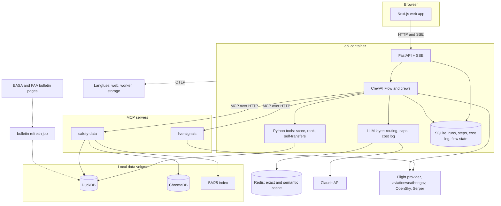
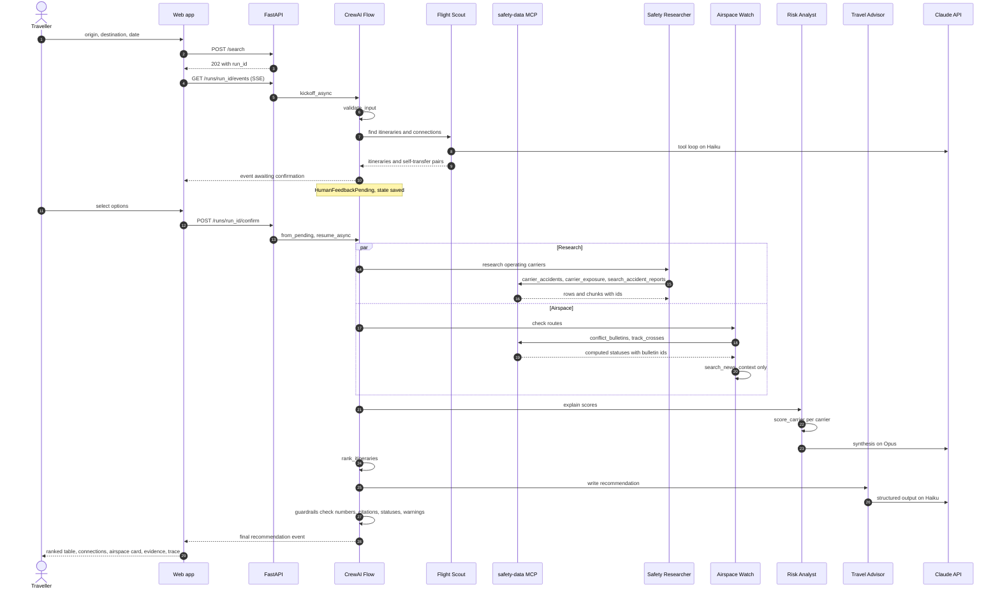
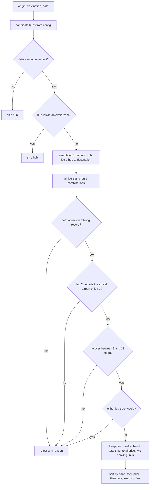
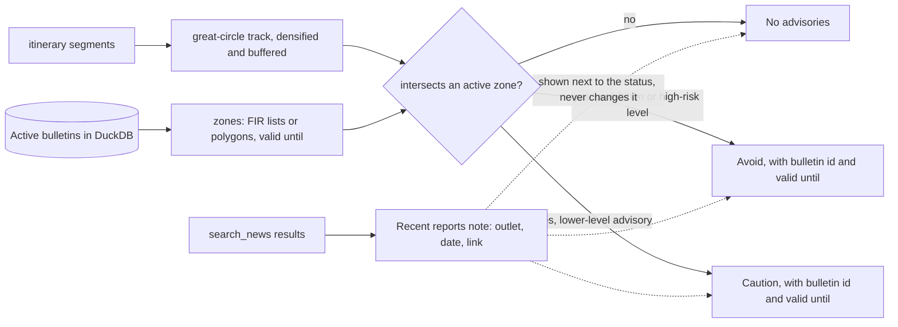
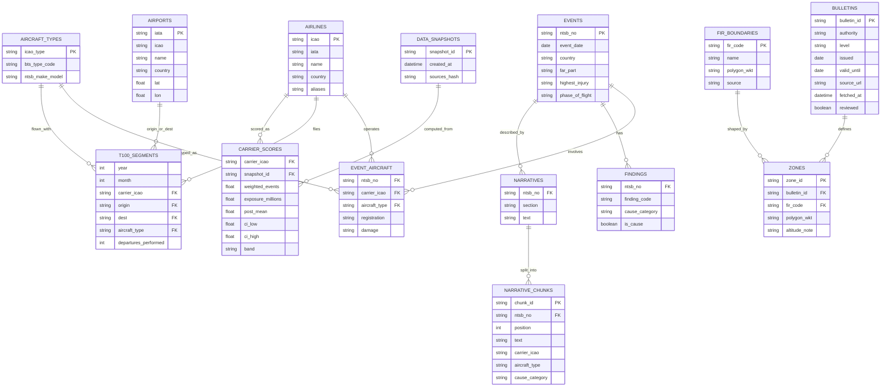
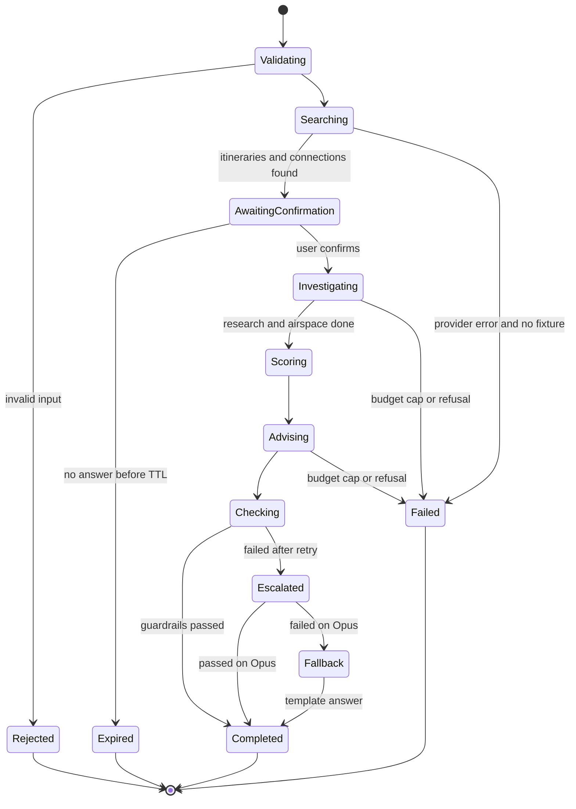
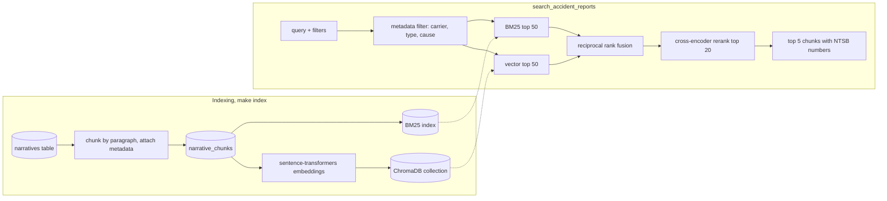
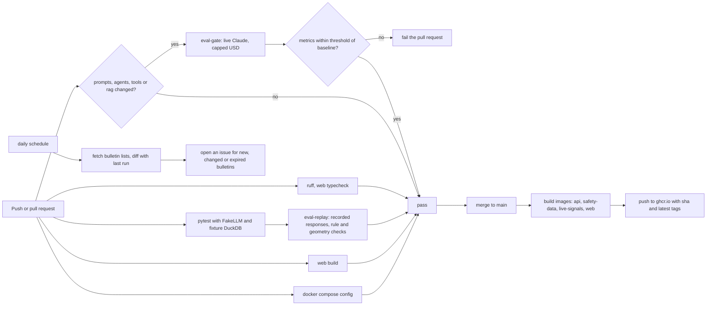
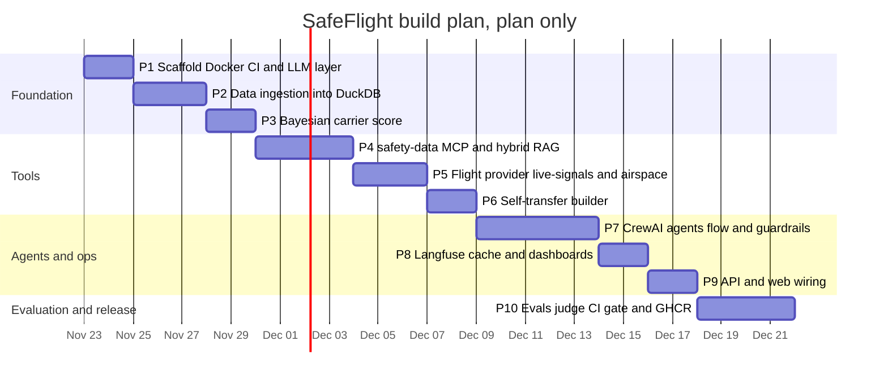

# SafeFlight AgentOps: overview, system design and workflow

Companion to [README.md](README.md). Pitches, interview questions and resume bullets are in [INTERVIEW.md](INTERVIEW.md). Everything here describes the design and the plan. The back end is not built yet (the `web/` front end exists on sample data), and where a measured number belongs it stays "—" until a real run fills it in `docs/results/`.

---

## Overview

### The problem

"Is this airline safe?" is a common question with poor answers online. Rankings rarely show their data, never show sample sizes, and treat an airline with 2,000 flights and no accidents as safer than one with 2 million flights and one minor accident. The public records that could give a careful answer (NTSB accident data, BTS traffic data, accident narratives, and the conflict-zone bulletins aviation authorities publish) are free but split across formats and agencies.

### What SafeFlight does

The user enters an origin airport, a destination airport and a date. A CrewAI Flow then:

1. validates the input in plain Python;
2. runs a **Flight Scout** agent that finds itineraries, records the **operating** carrier of every segment, and builds two-ticket connections through nearby hubs with `build_self_transfers`;
3. pauses so the user can confirm which options to research;
4. runs two agents in parallel: a **Safety Researcher** that gathers accident counts, exposure and accident-report evidence through MCP tools and hybrid RAG, and an **Airspace Watch** agent that checks every route against official airspace bulletins with a computed geometry test, adding news only as context;
5. runs a **Risk Analyst** agent that gets every number from a deterministic Bayesian scoring tool and explains it;
6. ranks the options in code: airspace status, then safety band, then price and duration;
7. runs a **Travel Advisor** agent that writes a structured, cited recommendation, including the separate-ticket warning for any self-transfer;
8. checks that recommendation with guardrails before the user sees it.

Around that sits the LLMOps layer (model routing, cost caps, a semantic cache, OpenTelemetry traces and versioned prompts in Langfuse), an eval harness with a calibrated LLM judge that gates pull requests, and Docker plus GitHub Actions for build and delivery.

### Ethics and limits, stated plainly

- Commercial aviation is extremely safe. Differences between major airlines are small, and most carriers will fall in the "Typical" band. The web app says this on every result.
- SafeFlight states facts from public records, with sources, and shows uncertainty and data gaps. It is not travel or safety advice.
- Airspace statuses come only from official bulletins and a geometry check. They do not replace airline or government decisions. A great-circle track is not the route an airline files, and airlines usually route around restricted areas already. News never sets a status.
- Self-transfers on two tickets carry real risks (no protection if the first flight is late, bags to re-check, possible transit visa rules), and the advisor must say so every time.
- Coverage is uneven. NTSB data covers accidents it investigates, mostly in the US, and BTS T-100 exposure covers US carriers and foreign carriers on flights to and from the US. Carriers with little US traffic get wide intervals or "Limited data".
- Aviation Safety Network is used only for manual cross-checks, because its terms limit scraping. Google Flights and Skyscanner are never scraped. SafeFlight never takes payment or stores card data.

---

## Tech stack deep dive

| Tool | What it does here | Why this and not the alternative |
|---|---|---|
| CrewAI (Flows + Crews) | Flow orchestrates the steps and state; each agent runs as a small crew with its own tools and task | **Why not LangGraph:** both would work. CrewAI's role/goal/task model maps directly onto five specialist agents, and Flows add explicit `@start`/`@listen`/`@router` control flow, `and_` joins for the parallel branches, typed state and `@human_feedback` for the pause. LangGraph gives finer graph control and a mature checkpointer; a LangGraph re-implementation compared on the same eval set is a stretch goal, so the choice gets measured instead of argued |
| Claude API (`anthropic` SDK) | Haiku 5.5 for scout, researcher, airspace watch, advisor and judge; Opus 5.5 for the analyst and advisor escalation | **Why Claude and not another provider:** strong tool use and structured outputs, prompt caching, and clear usage fields for cost logging; one provider keeps the LLM layer small. **Why two models:** most calls are tool loops where Haiku is far cheaper; synthesis and the escalation path get Opus |
| CrewAI `BaseLLM` adapter | Wraps the `anthropic` SDK so CrewAI agents call Claude through code I control | **Why not only CrewAI's built-in `LLM` class:** CrewAI's docs confirm a native Anthropic integration and token usage reporting, but do not document cache breakpoints or exposing `stop_reason`. The adapter gives both, plus cost caps. Fallback if the adapter fights CrewAI's tool calling: the built-in class, with that gap written down |
| MCP Python SDK (FastMCP) | Two servers: `safety-data` (DuckDB, RAG, bulletins, geometry) and `live-signals` (weather, OpenSky) | **Why MCP and not plain function tools:** a process boundary and a standard schema. The servers are tested alone, restarted alone, and usable from Claude Desktop or Claude Code for manual checks. **Why two servers:** `safety-data` is offline and deterministic, `live-signals` calls the internet and can fail; separating them keeps failure modes apart. Plain function tools are still used where a process boundary adds nothing (`score_carrier`, `rank_itineraries`, `build_self_transfers`) |
| DuckDB | Stores NTSB events, findings, narratives, T-100 segments, reference tables, scores, bulletins and zones | **Why not Postgres:** the data is read-mostly analytics over a few large files. DuckDB is one file, columnar, reads CSV and Parquet directly, and needs no server. Postgres would add a service for no gain; it would make sense if many writers shared the data |
| ChromaDB | Vector index of NTSB narrative chunks with metadata | **Why not FAISS:** FAISS is a fast index library but leaves metadata, persistence and filtering to me. **Why not pgvector:** it needs Postgres, which this design does not otherwise use. Chroma is embedded, persistent and supports `where` filters on carrier, aircraft type and cause |
| BM25 + cross-encoder | Lexical search and reranking next to vector search | Vector search alone misses exact terms (tail numbers, "rejected takeoff"); BM25 alone misses paraphrases. Fusion covers both, and a cross-encoder reads query and chunk together for a better final order |
| shapely + pyproj | Great-circle tracks, buffers, zone intersection | **Why not ask the LLM whether a route crosses a zone:** it would guess. Geometry is a solved, testable problem; a hand-built track set checks it |
| Deterministic scoring tool | `score_carrier` computes rates, shrinkage, intervals and bands in Python | **Why not let the LLM score:** LLMs are unreliable at arithmetic and inconsistent across runs. A scoring function is testable against hand-computed values, gives the same answer every time, and lets the guardrail check every number |
| Bayesian shrinkage | Poisson-Gamma empirical Bayes toward the industry rate | **Why not raw rates:** a raw rate from a tiny sample is noise; zero accidents in 5,000 departures would rank first. Shrinkage weights each carrier's own data by how much of it there is, and the posterior gives a credible interval for free |
| crewai-tools `SerperDevTool` | `search_news(region)` for recent reports | A search tool CrewAI documents, so no custom scraper. Its output is context only and never decides a status |
| Redis | Exact cache and semantic cache with a vector index | One small service covers both caches with TTLs; a dedicated vector database would be overkill for cache entries |
| Langfuse (self-hosted) | Traces, prompt versions, cost and latency dashboards | **Why not LangSmith:** tied to the LangChain ecosystem and hosted. **Why not Arize Phoenix:** strong tracing, but Langfuse adds prompt management in the same tool. **Why not plain Jaeger:** no LLM-specific views of tokens, cost or prompts. Langfuse is open source, runs in Docker Compose, accepts OpenTelemetry, and appears in CrewAI's observability docs |
| OpenTelemetry + OpenLIT | Spans for flow steps, agents, tools, MCP calls and LLM calls | OpenTelemetry is vendor-neutral, so traces can move to another backend. OpenLIT is the path CrewAI's Langfuse page documents |
| FastAPI + SSE | `POST /search`, `GET /runs/{id}/events`, `GET /runs/{id}`, `POST /runs/{id}/confirm` | **Why SSE and not WebSockets:** the stream is one-way (server to browser), SSE runs over plain HTTP, reconnects automatically and passes through proxies; the one client-to-server action, confirming the selection, is a normal POST |
| SQLite | Runs, steps, cost log and CrewAI flow persistence | CrewAI's default flow persistence is SQLite; one local writer is enough for a single-machine demo |
| Next.js + Tailwind + lucide-react | The `web/` app: search bar, interval chart, itinerary table, airspace card, connections, evidence drawer, agent trace | **Why not Streamlit:** the evidence drawer, interval chart and trace timeline need layout control, and the unslop rules are written for React and Tailwind |
| Docker + Compose | One image per service; Compose runs the whole stack | Same images locally and in CI; GHCR hosts them for anyone who wants to run the demo |
| GitHub Actions | Lint, tests, eval replay, eval gate, image build and push, scheduled bulletin check | Free for public repos, close to the code, and GHCR auth uses the built-in `GITHUB_TOKEN` |

### Concepts you must know

**CrewAI**
- An `Agent` has a `role`, `goal`, `backstory`, `llm` and `tools`. Defaults that matter here: `max_iter` 20 (lowered per agent), `allow_delegation` False, `cache` True for tool results, `max_retry_limit` 2.
- A `Task` has a `description`, `expected_output`, `agent`, optional `context` (outputs of earlier tasks), `output_pydantic` for structured output, and `guardrail` / `guardrails`. A function guardrail takes the task output and returns `(True, result)` or `(False, error_message)`; the error goes back to the agent, and `guardrail_max_retries` (default 3; set to 1 here) limits retries. A string guardrail creates an LLM-based check.
- A `Crew` runs agents and tasks with `Process.sequential` (default) or `Process.hierarchical` (needs a manager LLM). `kickoff()` returns a `CrewOutput` with `raw`, `pydantic`, `json_dict`, `tasks_output` and `token_usage`.
- A `Flow` is a class with methods wired by decorators: `@start()` for entry points, `@listen(method_or_label)` to run after another method, `@router()` to return a label that chooses the next listener, and `or_` / `and_` to combine triggers. `Flow[State]` with a Pydantic model gives typed state; every state has an `id`. Methods can kick off crews.
- `@human_feedback` (CrewAI 1.8.0+) pauses a flow for a person. With a custom `HumanFeedbackProvider`, the provider raises `HumanFeedbackPending`, state is saved, and a later request resumes with `Flow.from_pending(flow_id)` and `resume_async(feedback)`.
- Custom tools subclass `BaseTool` (with `name`, `description`, a Pydantic `args_schema` and `_run`) or use the `@tool` decorator. Tool descriptions are prompts.
- MCP tools load with `MCPServerAdapter` from `crewai-tools[mcp]`, used as a context manager; stdio, SSE and streamable HTTP are supported, tools can be filtered by name, and `connect_timeout` defaults to 30 seconds.
- `BaseLLM` is the documented way to plug in a custom LLM: implement `call(messages, tools, callbacks, available_functions)`.
- The event bus (`BaseEventListener`) emits flow, crew, agent, task, tool, LLM, guardrail and MCP events. SafeFlight uses it for OpenTelemetry spans and for the SSE stream.

**MCP (Model Context Protocol)**
- Roles: host (the app), client (one connection per server), server (exposes tools, resources and prompts). SafeFlight uses tools.
- Messages are JSON-RPC 2.0. Transports: stdio for local subprocesses, streamable HTTP for network services. SafeFlight uses streamable HTTP so each server is its own container.
- Clients list tools (name, description, JSON Schema) and call them by name. A vague description causes wrong tool choices.

**Claude API**
- Tool use loop: `stop_reason == "tool_use"` means run the tools and send all `tool_result` blocks back in one message; a failed tool returns `is_error: true` instead of being dropped.
- Always check `stop_reason` before reading content: `end_turn`, `tool_use`, `max_tokens` (truncated), `refusal` (declined, with `stop_details`).
- Prompt caching is a prefix match over tools, then system, then messages. Stable content first; any changed byte invalidates everything after it. Check `usage.cache_read_input_tokens`.
- On Opus 5.5, thinking cannot be turned off, effort defaults to `medium`, and forced `tool_choice` (`any` or a named tool) returns a 400. Sampling parameters are not sent.

**Hybrid retrieval**
- BM25 scores documents by term frequency and inverse document frequency, with length normalization.
- Reciprocal rank fusion: `score(d) = sum over lists of 1 / (k + rank_in_list(d))`, with `k` around 60. It needs no score calibration between BM25 and cosine similarity.
- A bi-encoder embeds query and document separately (fast, used for search); a cross-encoder reads them together (slower, more accurate, used to rerank the top candidates).
- Hit rate at k: share of queries with the expected document in the top k. MRR: mean of 1 / rank of the first relevant result.

**Statistics**
- Accident counts given exposure are modelled as Poisson: `y ~ Poisson(lambda * E)`.
- The Gamma distribution is conjugate to the Poisson rate: a Gamma(alpha, beta) prior and data (y, E) give a Gamma(alpha + y, beta + E) posterior.
- Empirical Bayes estimates the prior from all carriers, then applies it to each carrier.
- A 90% credible interval holds the rate with 90% posterior probability, given the model and prior.

**Airspace geometry**
- A great circle is the shortest path between two points on a sphere. It is densified into points every few tens of kilometres so it can be drawn as a line.
- Buffers must be built in a metric projection (for example an azimuthal equidistant projection centred on the segment), not in degrees, because a degree of longitude shrinks toward the poles.
- Routes that cross the 180th meridian are split into two lines before testing.
- A FIR (flight information region) is the unit most bulletins use; FIR boundary polygons come from an open dataset whose source and licence are recorded in Phase 5.

**LLM-as-a-judge**
- A second model scores outputs against a written rubric with anchored levels and must quote the text it judged.
- Judges have biases (verbosity, position, self-preference), so they are calibrated against human labels before their scores are trusted.
- Cohen's kappa measures agreement beyond chance: `kappa = (p_o - p_e) / (1 - p_e)`. Around 0.6 to 0.8 is usually read as substantial agreement.

**Tracing**
- A trace is one request; spans are its timed steps, nested by parent ID. Attributes carry model, tokens, cost, prompt version and tool name.
- OTLP is the export protocol; Langfuse accepts OTLP traces.

---

## System design and workflows

### 1. Architecture

Services as they run in Docker Compose. Solid lines are requests; dotted lines are trace export and the scheduled data refresh.



### 2. The CrewAI Flow

Flow methods and the routes between them. The router after validation stops bad input before any LLM call; research and airspace run in parallel and join with `and_` before ranking; the guardrail path ends in one of three outcomes.

```mermaid
flowchart LR
    S(("start")) --> VAL["validate_input"]
    VAL --> R1{"route_after_validation"}
    R1 -->|"invalid"| REJ["return 422 details"]
    R1 -->|"valid"| SCOUT["scout_crew: search_flights, build_self_transfers, recent_route_activity"]
    SCOUT --> HF{"confirm_selection: human_feedback"}
    HF -->|"selected ids"| RES["research_crew: MCP tools, hybrid RAG"]
    HF -->|"selected ids"| AIR["airspace_crew: conflict_bulletins, track_crosses, search_news"]
    RES --> ANA["analysis_crew: score_carrier"]
    ANA --> JOIN{"and_ join"}
    AIR --> JOIN
    JOIN --> RANK["rank_itineraries, deterministic"]
    RANK --> ADV["advice_crew on Haiku"]
    ADV --> R2{"route_after_guardrail"}
    R2 -->|"passed"| DONE["publish recommendation"]
    R2 -->|"failed after one retry"| OPUS["advice_crew on Opus"]
    OPUS --> R3{"route_after_escalation"}
    R3 -->|"passed"| DONE
    R3 -->|"failed"| TPL["template fallback from data"]
    TPL --> DONE
```



### 3. Sequence of one search

From the form submit to the final recommendation. The run pauses at the confirm step and resumes on a second request.



### 4. Self-transfer pairing

How `build_self_transfers` turns hub searches into the "Safer connections on two tickets" section. Every rule is code, and each rejection reason is logged so the eval can count them.



### 5. Airspace status decision

Official bulletins and geometry decide the status. News is attached as a note and has no path to the status.



### 6. Data model

DuckDB tables built by the ingestion and bulletin scripts. `narrative_chunks` is the single source for both the BM25 index and the ChromaDB collection, so the two always agree.



### 7. Run lifecycle

The states one run moves through, as stored in SQLite and shown in the web app. Failed covers errors, refusals and budget caps.



### 8. Hybrid retrieval pipeline

Offline indexing on the left, the query path on the right.



### 9. CI/CD workflow

Every push runs lint, tests and the free replay eval, including the self-transfer rule and geometry checks. The live eval gate runs only when prompts, agents, tools or retrieval change, under a dollar cap. Images are pushed to GHCR from `main`. A scheduled workflow checks the bulletin sources daily and opens an issue when a bulletin is added, changed or expires.



### 10. Build plan

Plan only, not actuals. Dates are targets for about four weeks of work.



---

## Scoring method

`score_carrier(carrier)` is plain Python (NumPy and SciPy). No LLM is involved.

**Events.** NTSB accidents in the 10-year window where the carrier is the operator and the flight was under FAR Part 121 (US air carriers) or Part 129 (foreign air carriers operating in the US). Each event gets a weight:

```
w_i = s(severity_i) * 0.5 ** (age_i / h)

s(fatal) = 1.0, s(serious) = 0.5, s(minor or none) = 0.2   (starting defaults, in config)
h = 5 years half-life                                       (starting default, in config)
age_i = years between the event and the end of the window
```

**Exposure.** Departures performed from T-100, recency-weighted the same way so the numerator and denominator match:

```
E_c = sum over years of departures_c,year * 0.5 ** (age_year / h) / 1,000,000
y_c = sum of w_i for carrier c
```

**Model.** Weighted counts are treated as Poisson with a Gamma prior on the rate:

```
y_c ~ Poisson(lambda_c * E_c)
lambda_c ~ Gamma(alpha, beta)          shape alpha, rate beta
posterior: lambda_c | y_c ~ Gamma(alpha + y_c, beta + E_c)
```

**Empirical Bayes prior.** Fit once per data snapshot by the method of moments over carriers with enough exposure:

```
m = sum(y) / sum(E)                                          pooled industry rate
v = variance of raw rates y_c / E_c  -  m * mean(1 / E_c)    between-carrier variance, floored above 0
alpha = m^2 / v,  beta = m / v
```

A maximum-likelihood fit of the negative binomial marginal is run as a check; large disagreement between the two fits is a data problem to investigate.

**Outputs.**

```
posterior mean   = (alpha + y_c) / (beta + E_c)
90% interval     = Gamma(alpha + y_c, beta + E_c) quantiles at 0.05 and 0.95
shrinkage weight = E_c / (beta + E_c)     share of the estimate that comes from the carrier's own data
```

**Bands.** These match the labels the `web/` app already uses, plus one it still needs:

- **Limited data** if the carrier's recency-weighted exposure is below 1 million departures, or it has no T-100 exposure at all. (The first design used "shrinkage weight below 0.5"; on the real data the between-carrier variance is at the floor, the prior is tight, and that rule labelled every carrier Limited data, including Southwest with 7 million departures. A plain exposure threshold says what the label means.)
- **Strong record** if the upper interval bound is below `m`;
- **Higher rate** if the lower interval bound is above `m` (the sample-data UI has no state for this yet; Phase 9 adds it);
- **Typical** otherwise.

**Worked example (illustrative numbers, not data).** Suppose the fitted prior is `alpha = 2`, `beta = 4`, so the industry rate is `m = 0.5` weighted accidents per million departures.

| Carrier | y_c | E_c (millions) | Raw rate | Posterior mean | Shrinkage weight | Band |
|---|---|---|---|---|---|---|
| A, small | 0 | 0.2 | 0.0 | 2 / 4.2 = 0.476 | 0.048 | Limited data |
| B, large | 6 | 20 | 0.30 | 8 / 24 = 0.333 | 0.833 | depends on interval |
| C, tiny | 1 | 0.02 | 50.0 | 3 / 4.02 = 0.746 | 0.005 | Limited data |

Carrier A's raw rate of zero would rank it best; shrinkage keeps it near the industry rate and the band says the data is too thin. Carrier C's raw rate of 50 would rank it far worst; one event on a tiny base does not support that. These exact cases become unit tests in Phase 3.

**Known approximations.** Weighted counts are not integers, so the Poisson likelihood is a working model, not an exact one. Severity weights are judgment calls; Phase 3 includes a sensitivity check that reports how many bands change under other reasonable weights.

**What the real data showed (Phase 3 run, raw output in `docs/results/scoring/`).** 275 NTSB accidents on Part 121/129 flights in the US from 2016 to 2025; 262 attributed to a BTS carrier. The method-of-moments estimate of between-carrier variance came out at or below the floor (coefficient of variation 10%), and the maximum-likelihood check agreed (very large alpha and beta): **US carriers' accident rates are not distinguishable beyond chance in this window**. The 13 largest carriers all land in Typical, every other carrier is Limited data, and neither alternative severity weighting changes a single band. SafeFlight says this plainly instead of inventing a ranking; when bands tie, ranking falls through to price and duration. Accidents outside the US are excluded because T-100 exposure only covers flights to, from and within the US.

**Itineraries and ranking.** An itinerary's band is the band of its weakest segment's operating carrier, and its airspace status is the worst status of its segments. `rank_itineraries` sorts by airspace status (No advisories, Caution, Avoid), then band (Strong record, Typical, Higher rate, then Limited data, which is labelled and never called safer or less safe), then price, then duration. Two-ticket connections are ranked the same way in their own section.

---

## Trade-offs and what I'd change at 10x scale

**Trade-offs in the current design**

- **US-centred data.** NTSB and T-100 give a consistent numerator and denominator for flights touching the US, but say little about a carrier's domestic operations elsewhere. The scope is stated on every result instead of being hidden.
- **Carrier identity matching.** NTSB operator names are free text in older records. Matching uses ICAO codes where present, then an alias table and fuzzy matching, with data tests on the largest carriers. Some events will be missed or misattributed; the evidence drawer shows the raw operator name so a person can check.
- **Weighted Poisson.** Simple and explainable, but an approximation. A model with separate rates per severity would be more correct and harder to explain.
- **Strict "Strong record" rule for self-transfers.** Because "Strong record" needs the whole interval below the industry rate, many routes will have no qualifying pair, and the section will say so. Allowing "Typical" is a config switch, not a code change.
- **Great-circle tracks for airspace.** Computable for every itinerary, but not what airlines fly; it over-flags routes that airlines already divert. The wording says "the direct track crosses", and the filed FIR sequence is used when known.
- **Bulletin extraction.** FIR codes and coordinates are parsed from bulletin text, then reviewed. New bulletins are used at once with their parsed FIR list and marked "pending review", because missing a new prohibition is worse than showing an unreviewed one.
- **Deterministic ranking, LLM explanation.** The LLM cannot change the order or a status, which is safe but means the advisor adds words, not judgment. That is intended: the judgment lives in tested functions.
- **Human confirmation.** Cuts cost and keeps the user in control, but adds a step and a paused state to manage (expiry after a TTL).
- **Semantic cache.** Saves calls on near-duplicate research, but a false hit returns the wrong carrier's summary. Keys are scoped by carrier and snapshot, airspace results are never semantically cached, and the false-hit rate is reported.
- **Live eval gate.** Catches prompt regressions before merge, but costs money and has run-to-run variance. It runs only on relevant paths, under a cap, with thresholds wider than the observed noise.
- **Two MCP servers in containers.** Clean boundaries and reuse, at the cost of network hops and more services to start.

**At 10x scale (many users, many routes)**

- Postgres for runs, steps and flow persistence; workers pulling flow runs from a queue with per-user rate limits.
- Precompute carrier scores, research summaries and hub leg searches per data snapshot, so most searches need only the scout and the advisor.
- A licensed global data source for accidents and exposure, which would change the coverage story more than any code change; a commercial transit visa data source for self-transfers.
- Filed flight plan routes instead of great circles for airspace checks.
- MCP servers behind authentication with per-tenant limits.
- Message Batches for nightly judge evals at half price.
- Kubernetes with a Helm chart once more than one machine is needed (a stretch goal here).

---

## Glossary

- **Agent (CrewAI)**: an LLM with a role, goal, backstory and tools that performs tasks.
- **BM25**: a lexical ranking function based on term frequency, inverse document frequency and document length.
- **Codeshare**: one flight sold under several airlines' flight numbers; only one airline operates it.
- **Cohen's kappa**: agreement between two raters corrected for agreement expected by chance.
- **Credible interval**: a range that contains the parameter with a stated posterior probability.
- **Crew**: a group of CrewAI agents and tasks run together with a process.
- **Cross-encoder**: a model that reads a query and a document together and outputs a relevance score; used to rerank.
- **CZIB (Conflict Zone Information Bulletin)**: EASA's published advice to EU operators about risk in a conflict zone, with an ID and a validity date.
- **Detour ratio**: the distance via a hub divided by the direct distance; used to pick sensible hubs.
- **Empirical Bayes**: estimating the prior from the data of all groups, then applying it to each group.
- **Exposure**: the amount of activity at risk; here, departures performed.
- **FAR Part 121 / Part 129**: US rules for domestic and flag air carriers, and for foreign air carriers operating in the US.
- **FIR (flight information region)**: a block of airspace with defined boundaries in which flight information and alerting services are provided.
- **Flow (CrewAI)**: an event-driven workflow of methods wired with `@start`, `@listen` and `@router`, with typed state.
- **GHCR**: GitHub Container Registry.
- **Great circle**: the shortest path between two points on a sphere.
- **Guardrail (CrewAI task)**: a function or LLM check on a task's output that can reject it and send feedback for a retry.
- **Hit rate at k**: share of queries whose expected document appears in the top k results.
- **Human-in-the-loop**: a person approves or chooses before the system continues.
- **IATA / ICAO codes**: two- or three-letter airline and airport codes; IATA is used in booking, ICAO in operations.
- **LLM-as-a-judge**: using an LLM with a rubric to grade another model's output.
- **Marketing vs operating carrier**: the airline that sells the ticket vs the airline that flies the aircraft.
- **MCP (Model Context Protocol)**: an open protocol for exposing tools, resources and prompts to LLM apps through servers.
- **METAR / TAF**: a routine airport weather observation, and a terminal aerodrome forecast.
- **MRR (mean reciprocal rank)**: mean of 1 / rank of the first relevant result across queries.
- **NOTAM**: a notice to air missions about hazards or restrictions; the FAA publishes international security NOTAMs for foreign airspace.
- **NTSB**: US National Transportation Safety Board, which investigates civil aviation accidents.
- **OpenTelemetry (OTel)**: a vendor-neutral standard for traces, metrics and logs; OTLP is its export protocol.
- **Poisson-Gamma model**: Poisson counts with a Gamma prior on the rate; the posterior is also Gamma.
- **Prompt caching**: reusing a processed prompt prefix across calls to cut cost and latency.
- **Reciprocal rank fusion (RRF)**: merging ranked lists by summing 1 / (k + rank).
- **Self-transfer**: a connection built from two separate tickets; the airlines do not coordinate, so a missed connection is the traveller's problem.
- **Semantic cache**: a cache looked up by embedding similarity instead of exact key.
- **Server-Sent Events (SSE)**: a one-way HTTP stream from server to browser.
- **SFAR**: a Special Federal Aviation Regulation; several prohibit US operators from flying in named foreign FIRs.
- **Shrinkage**: pulling noisy estimates toward a group mean, more strongly when data is thin.
- **Span**: one timed step inside a trace.
- **`stop_reason`**: the Claude API field saying why generation stopped.
- **Structured output**: a model response constrained to a schema, here a Pydantic model.
- **T-100 segment data**: BTS monthly data on flights by carrier, airport pair and aircraft type, including departures performed.
