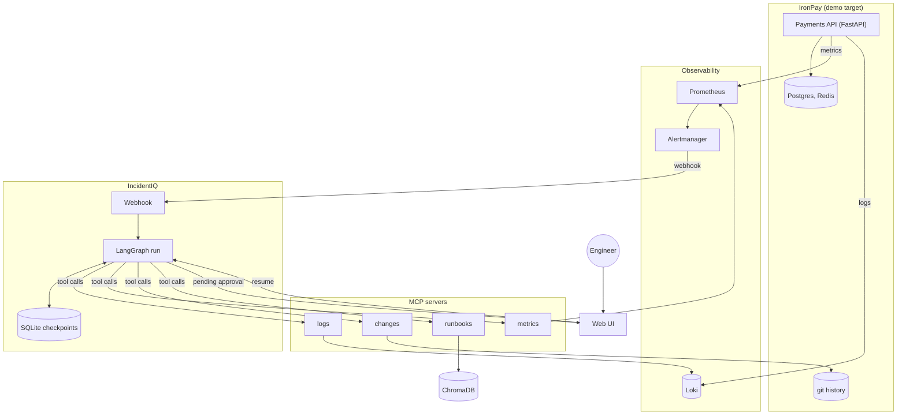
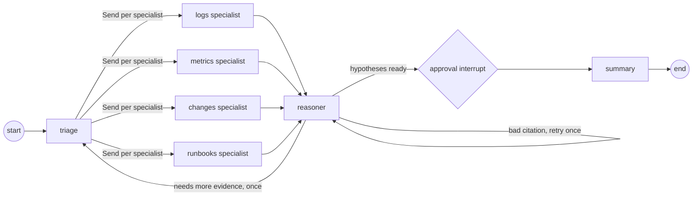
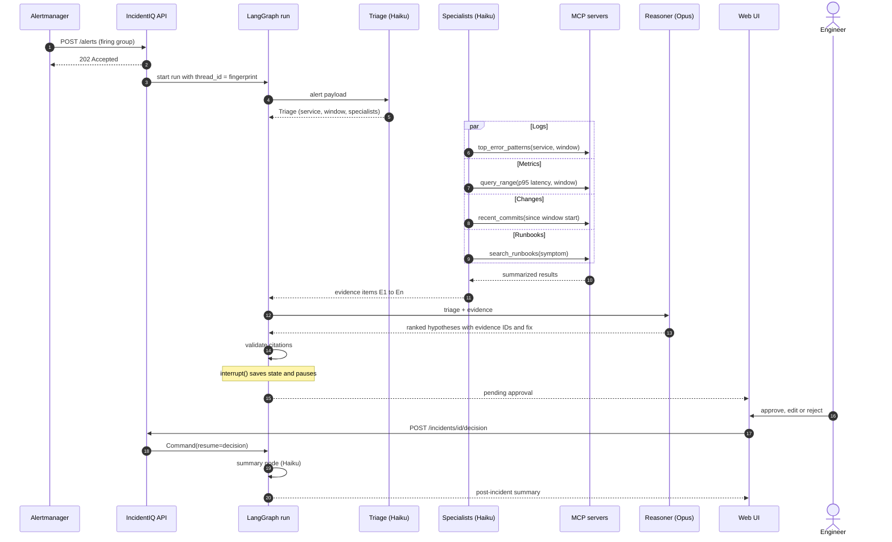
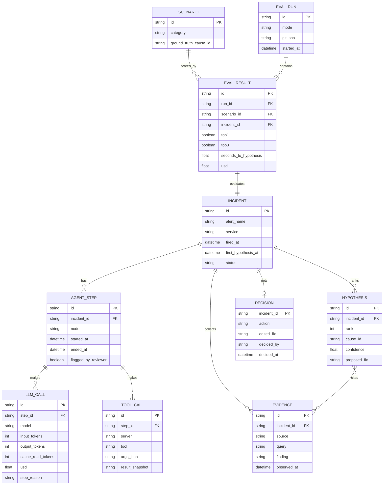
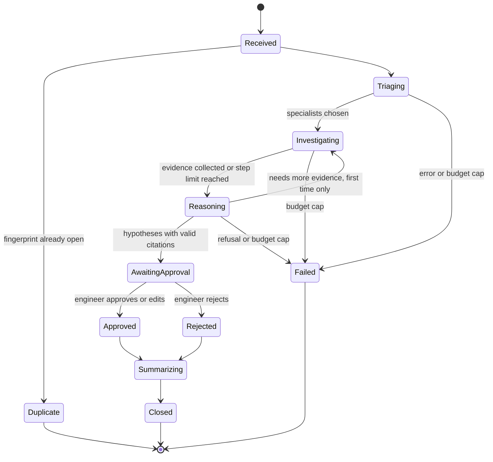
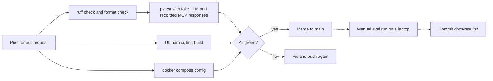
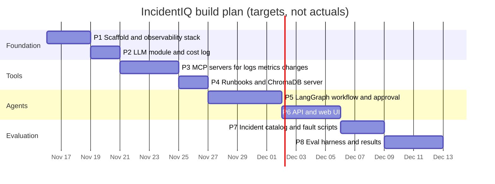

# IncidentIQ AgentOps: overview, system design and workflow

Companion to [README.md](README.md). Pitches, interview questions and resume bullets are in [INTERVIEW.md](INTERVIEW.md). Everything here describes the design and the plan; where a number belongs it stays a placeholder until a real run fills it in `docs/results/`.

---

## Overview

"The problem is the first 20 minutes of an incident. The on-call engineer does the same things every time: look at the dashboard, query logs, check what was deployed, find the runbook. I wanted to see how much of that an agent system can do reliably, and to measure it instead of guessing.

The setup is all in Docker Compose. IronPay, my payments API with Postgres and Redis, runs next to Prometheus, Alertmanager, Loki and Grafana. Alert rules on error rate and latency fire through Alertmanager to a FastAPI webhook in IncidentIQ.

Each incident is one LangGraph run. The first node is triage, on Claude Haiku: it turns the alert JSON into a typed object with the service, the time window and which specialists to run. Then the specialists run in parallel. Each one is a small tool-use loop on Haiku with a cap of six tool calls, and its tools come from an MCP server. I have four servers: Loki for logs, Prometheus for metrics, git for recent commits and config diffs, and ChromaDB for runbook search. The tools are read-only and they summarize on the server side, so the model gets grouped error patterns with counts, not thousands of raw lines.

Every piece of evidence gets an ID. The reasoning node runs on Claude Opus and returns structured output: up to three hypotheses, each with a cause from a fixed taxonomy, a confidence, the evidence IDs it relies on, and a proposed fix. My code checks the citations, and if one points at nothing, the model has to fix it.

Then the graph hits a LangGraph interrupt. State is checkpointed in SQLite, and the web UI shows the timeline and the proposed fix. When I approve or reject, the API resumes the graph and a summary agent writes the post-incident report.

For evaluation I wrote 15 to 20 fault scripts: kill a container, drop an index, set a bad config value, squeeze memory, deploy a bad commit. Each has a ground-truth cause ID, so scoring is exact match, top-1 and top-3. I also save every tool response as a snapshot, so I can re-run just the reasoning step after a prompt change without breaking the stack again. That matters because my whole API budget is about 100 dollars. The results are [measured top-1], [measured top-3], [measured median time] to first hypothesis and [measured USD] per incident."

---

## Tech stack deep dive

| Tool | What it does here | Why this and not the alternative |
|---|---|---|
| LangGraph | Runs the incident workflow as a graph: triage, parallel specialists, reasoning, approval, summary | Why not a plain Python loop: I would have to build checkpointing, parallel fan-out and pause/resume myself. Why not CrewAI or AutoGen: they hide the control flow, and I want each edge explicit and testable |
| MCP Python SDK | Four tool servers (logs, metrics, changes, runbooks) that the agents call | Why not plain Python functions: MCP gives a process boundary and a standard schema, so the same tools work from Claude Desktop, Claude Code or another agent, and they are tested on their own |
| Claude via `anthropic` SDK | Haiku 5.5 for triage, specialists and summary; Opus 5.5 for root-cause reasoning | Why not one model for everything: most calls are simple tool loops where Haiku is far cheaper; the one hard judgment call gets Opus. Why the raw SDK and not LangChain's chat wrappers: I see the exact request, usage fields and `stop_reason` |
| ChromaDB | Stores runbook chunks with metadata and serves similarity search | Why not pgvector or Pinecone: a dozen runbooks do not need a server or a paid service; Chroma runs embedded in the runbooks MCP server |
| Prometheus + Alertmanager | Scrapes IronPay, Postgres, Redis and container metrics; alert rules fire webhooks | Why not Datadog or CloudWatch: free, local, and PromQL is what most SRE teams use |
| Loki + Grafana Alloy | Alloy ships Docker container logs to Loki; the logs server queries with LogQL | Why not Elasticsearch: Loki indexes only labels, so it is light enough for a laptop, and it pairs with Grafana |
| Grafana | Dashboards for checking IncidentIQ's claims by hand | Needed to verify the evidence the agents cite |
| FastAPI | Alert webhook, incident API, approval resume endpoint | Async, Pydantic models shared with the graph state, same framework as IronPay |
| SQLite | Incidents, LangGraph checkpoints, cost log | Why not Postgres: single-writer local demo; the LangGraph checkpointer interface makes a later swap to Postgres small |
| Next.js + Tailwind | Incident list, timeline and approval UI, eval table | Why not Streamlit: I need a polished approval flow and full control over layout, and the unslop rules are written for React and Tailwind |
| Docker Compose | Brings up IronPay, observability, MCP servers, IncidentIQ and the UI | Why not Kubernetes: one machine, one command; the fault scripts use `docker` commands directly |
| pytest + GitHub Actions | Unit tests, MCP server tests on recorded responses, graph tests with a fake LLM | Tests must not need an API key or spend money |

### Concepts you must know

**LangGraph**
- A `StateGraph` has a typed state (a `TypedDict` or Pydantic model), nodes that return partial state updates, and edges.
- Reducers decide how updates merge. A key like `evidence: Annotated[list[Evidence], operator.add]` lets parallel nodes append without overwriting each other. Without a reducer, two parallel writes to the same key raise an error.
- Parallel branches run in the same superstep. Dynamic fan-out uses conditional edges that return `Send("specialist", payload)` objects, one per specialist triage chose.
- A checkpointer (here `SqliteSaver`) saves state after each superstep, keyed by `thread_id`. That is what makes pause, resume and crash recovery possible.
- `interrupt(value)` pauses the run and surfaces `value` to the caller. Resuming with `Command(resume=decision)` re-runs the interrupted node from its start, and `interrupt()` returns the decision. Code before the `interrupt()` call must be safe to run twice.
- `recursion_limit` caps total steps and guards against loops.

**MCP (Model Context Protocol)**
- Three roles: host (the app), client (one connection per server), server (exposes capabilities).
- Servers expose tools (functions the model can call), resources (readable data) and prompts (templates). IncidentIQ uses tools.
- Messages are JSON-RPC 2.0. Transports are stdio (local subprocess) and streamable HTTP (network service). IncidentIQ uses streamable HTTP so each server is its own container.
- The client calls `list_tools` to get names, descriptions and JSON Schemas, then `call_tool` to run one. IncidentIQ converts each MCP tool schema into a Claude tool definition.
- Tool descriptions are prompts. A vague description causes wrong tool choices.

**Claude API (`anthropic` SDK)**
- Tool use loop: send `tools`, get `stop_reason == "tool_use"` with `tool_use` blocks, run them, send `tool_result` blocks back in one user message, repeat until `end_turn`.
- Claude can ask for several tools in one turn. All results go back together in a single message. A failed tool returns a `tool_result` with `is_error: true` instead of being dropped.
- Always check `stop_reason` before reading content: `end_turn`, `tool_use`, `max_tokens` (truncated), `refusal` (declined; `stop_details` says why), `pause_turn`.
- Structured outputs: `client.messages.parse()` with a Pydantic model, or `output_config.format` with a JSON Schema, makes the response match the schema. On Opus 5.5, forced `tool_choice` (`any` or a named tool) returns a 400, so structured outputs are the way to get guaranteed JSON.
- Effort (`output_config.effort`) trades depth for tokens. Opus 5.5 defaults to `medium` and its thinking cannot be turned off, so IncidentIQ sets effort explicitly per node.
- Prompt caching is a prefix match over `tools`, then `system`, then `messages`. Stable content goes first; one changed byte invalidates everything after it. Check `usage.cache_read_input_tokens` to confirm hits. Prefixes below a model-dependent minimum length are not cached.
- `usage` reports `input_tokens`, `output_tokens`, `cache_creation_input_tokens` and `cache_read_input_tokens`. The cost log multiplies these by a price table kept in config.
- Message Batches run requests asynchronously at half price, with results keyed by `custom_id` in any order.

**ChromaDB and RAG**
- A collection stores ids, documents, embeddings and metadata. Querying embeds the query and returns nearest neighbors.
- The default embedding function runs a small sentence-transformer model locally through ONNX, so there is no API cost.
- Chunking by markdown heading keeps each chunk about one failure mode, which retrieves better than fixed-size chunks for short runbooks.
- `where` filters on metadata (for example `{"service": "payments-api"}`) narrow the search before similarity ranking.
- Retrieval quality is measured separately from the agent, with a small set of questions and their expected runbook (hit rate at k).

**Prometheus and Alertmanager**
- Pull model: Prometheus scrapes `/metrics` endpoints on an interval.
- Metric types: counter (only goes up, use `rate()`), gauge (goes up and down), histogram (buckets, use `histogram_quantile()` for p95).
- `rate(http_requests_total{status=~"5.."}[5m])` is the per-second 5xx rate averaged over 5 minutes.
- Alert rules have a `for:` duration so a brief spike does not fire. Alertmanager groups, deduplicates, silences and routes alerts, and each group has a fingerprint.
- Label cardinality: every unique label combination is a new time series. Never put user IDs or request IDs in labels.
- cAdvisor exposes container CPU, memory and restart metrics; exporters expose Postgres and Redis internals.

**Loki and LogQL**
- Loki indexes only labels (container, service, level), not log text. Queries pick streams by label, then filter lines.
- `{service="payments-api"} |= "error" | json | status >= 500` is a stream selector, a line filter, a parser and a label filter.
- Metric queries such as `sum by (pattern) (count_over_time(...[5m]))` turn logs into counts, which is how `top_error_patterns` stays small.
- High-cardinality labels hurt Loki the same way they hurt Prometheus.

**Docker Compose**
- `healthcheck` plus `depends_on: condition: service_healthy` controls start order.
- `mem_limit` and `restart: "no"` are how memory-pressure and crash scenarios are created.
- `include:` pulls IronPay's compose file into the IncidentIQ stack.

**FastAPI**
- The webhook returns `202 Accepted` right away and starts the graph run in the background; Alertmanager should never wait on an LLM.
- Pydantic models validate the Alertmanager payload and are shared with the graph state types.

**Next.js and Tailwind**
- The UI is a client of the IncidentIQ API; it polls the incident endpoint every few seconds while a run is active.
- Tailwind's spacing scale is on a 4px grid, which matches the unslop spacing rule.

**pytest and GitHub Actions**
- The fake LLM provider returns scripted responses, so graph tests check routing, reducers, citation checks and interrupt/resume without network calls.
- MCP server tests use recorded Loki and Prometheus responses as fixtures.
- CI runs ruff, pytest, the UI build and `docker compose config`. The live eval never runs in CI because it costs money and needs the full stack.

---

## System design and workflows

### 1. System flowchart

IronPay emits metrics and logs, an alert starts a LangGraph run, specialists gather evidence through MCP, and a human approves the proposed fix.

### 2. The LangGraph graph

Triage fans out to the chosen specialists, the reasoner may loop back once for more evidence, and the approval node pauses the run.

### 3. Sequence of one incident

One alert from firing to summary. The specialists run in parallel, and the run is paused while the engineer decides.

### 4. Data model

What the SQLite store keeps. Hypotheses cite evidence many-to-many, and eval results link a scenario to the incident it produced.

### 5. Incident lifecycle

The states one incident moves through. Failed covers errors, refusals and budget caps.

### 6. CI/CD workflow

Every push runs lint, tests with the fake LLM, the UI build and a compose check. The live eval is run by hand because it costs money.

### 7. Build plan

Plan only, not actuals. Dates are targets for about four weeks of work.

---

## Trade-offs and what I'd change at 10x scale

**Trade-offs in the current design**

- **Closed cause taxonomy.** Exact, cheap scoring, but narrower than real incidents. The `other` option and unused taxonomy entries reduce the bias without removing it.
- **Scripted faults.** Reproducible and labeled, but cleaner than real outages, which often have several overlapping causes. Accuracy here is an upper bound on real-world accuracy.
- **SQLite and in-process background runs.** Simple and enough for one machine, but a single writer and no queue.
- **Read-only tools plus human approval.** Safe, but IncidentIQ cannot verify a fix by applying it. Time to recovery still depends on a human.
- **Server-side summarization in MCP tools.** Fewer tokens and clearer evidence, but the summary logic can hide the one log line that mattered. The raw query is stored with each evidence item so a human can open it in Grafana.
- **Replay evals.** Cheap and reproducible for the reasoning step, but they do not test whether specialists would pick different queries after a prompt change. Live runs are still needed before publishing numbers.

**At 10x scale (many services, many incidents)**

- Postgres for the incident store and LangGraph checkpoints; workers pulling runs from a queue with per-team concurrency and budget limits.
- MCP servers deployed as shared services with authentication, per-tenant data scoping and rate limits.
- Alert correlation before investigation: one run per real incident, not per alert group.
- Runbooks owned by service teams, indexed with service and version metadata; pgvector or a managed vector store once the corpus is large.
- Reuse evidence across related incidents within a time window instead of re-querying.
- Tracing with OpenTelemetry or Langfuse for per-step latency and cost dashboards.
- A larger eval set built from real past incidents and postmortems, plus an LLM-judged score for free-text causes.
- Message Batches for nightly replay evals at half price.

---

## Glossary

- **Alert group / fingerprint**: Alertmanager bundles related alerts into a group with a stable ID; IncidentIQ uses it as the incident ID.
- **Alertmanager**: Receives alerts from Prometheus, groups, deduplicates and routes them, and sends webhooks.
- **cAdvisor**: Exposes per-container CPU, memory and restart metrics to Prometheus.
- **Cardinality**: The number of unique label combinations; high cardinality makes Prometheus and Loki slow and expensive.
- **Cause ID / taxonomy**: The fixed list of root-cause labels the reasoner chooses from and the eval scores against.
- **Checkpointer**: LangGraph component that saves graph state after each step, keyed by `thread_id`.
- **Effort**: Claude API setting that trades reasoning depth for token spend.
- **Evidence item**: One numbered finding from a specialist: source, query, finding, timestamp.
- **Evidence snapshot**: Saved MCP tool calls and responses from a live run, replayed in eval replay mode.
- **Fault injection**: Breaking a system on purpose to test detection and response; the base idea of chaos engineering.
- **Human-in-the-loop (HITL)**: A person approves or corrects the system's output before it takes effect.
- **Interrupt**: LangGraph function that pauses a run and waits for a value passed back with `Command(resume=...)`.
- **LogQL**: Loki's query language: a label selector, then line filters, parsers and aggregations.
- **MCP (Model Context Protocol)**: Open protocol for exposing tools, resources and prompts to LLM apps through servers.
- **MTTD / MTTR**: Mean time to detect and mean time to resolve an incident.
- **OOMKilled**: A container killed by the kernel for exceeding its memory limit.
- **Post-incident summary (postmortem)**: A blameless write-up of what happened, why, and what to change.
- **Prompt caching**: Reusing a processed request prefix across calls to cut cost and latency.
- **PromQL**: Prometheus's query language for time series.
- **RAG (retrieval-augmented generation)**: Retrieving relevant documents and putting them in the prompt.
- **Reducer**: Function that tells LangGraph how to merge updates to one state key, such as list concatenation.
- **Runbook**: Step-by-step guide for diagnosing and fixing a known failure.
- **Specialist agent**: A IncidentIQ node that investigates one data source through one MCP server.
- **`stop_reason`**: Field in a Claude response saying why generation stopped: `end_turn`, `tool_use`, `max_tokens`, `refusal` and others.
- **Structured outputs**: Claude API feature that makes the response match a given JSON Schema.
- **Superstep**: One round of LangGraph execution in which all ready nodes run, possibly in parallel.
- **Top-k accuracy**: Share of cases where the correct answer is among the first k ranked answers.
