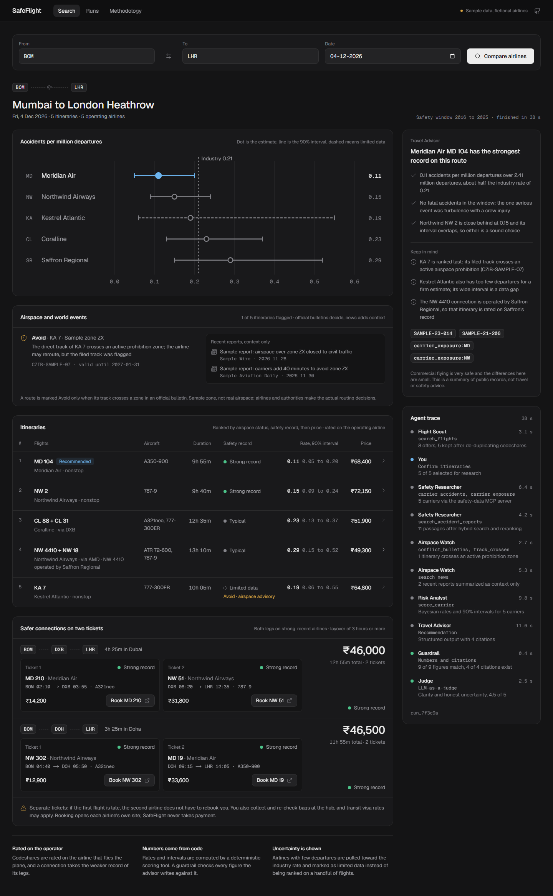
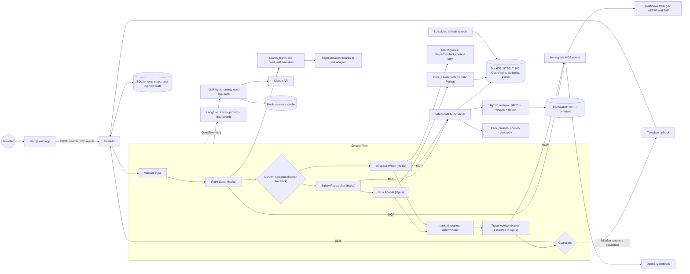

# SafeFlight AgentOps

A CrewAI multi-agent research assistant on the Claude API: enter two airports and a date, and agents find the flights, research each operating airline's public safety record, check official airspace bulletins, suggest safe two-ticket connections, and explain the options with evidence, uncertainty and price trade-offs.

Status: design spec and build plan. The back end is not built yet; a front end exists in `web/` and runs on clearly labelled sample data. Every result below is a "—" placeholder until a real run fills it.

             

---

## Why this exists

People who are nervous about flying often search "is airline X safe" and land on rankings with no sources, no sample sizes and no uncertainty. The public data to answer the question more honestly exists: the NTSB accident database, BTS traffic data, the accident reports themselves, and the conflict-zone bulletins that aviation authorities publish. It is spread across formats that a traveller will never join by hand.

SafeFlight joins them. A CrewAI Flow runs five agents on the Claude API: one finds itineraries and builds two-ticket connections, one researches each operating airline through MCP tools and a RAG index of NTSB accident narratives, one checks every route against official airspace bulletins, one turns the numbers into a statistically careful score through a deterministic tool, and one writes a recommendation that cites every number, report and bulletin it uses. Guardrails reject any answer whose numbers or citations do not match the data, and a Claude judge, checked against human labels, grades every change in CI.

### What this is not

- Commercial aviation is extremely safe, and the differences between major airlines are small. Most carriers land in the "Typical" band, and SafeFlight says so.
- It reports facts from public records with their sources, shows uncertainty and data gaps, and is **not travel or safety advice**.
- Airspace statuses come from official bulletins and a geometry check. They **do not replace airline or government decisions**: airlines plan their own routes and often fly around restricted areas already.
- It never scrapes Google Flights or Skyscanner, never takes payment and never stores card data.

## What it does

- **Route search.** The user enters origin and destination IATA codes and a date. Input is validated against the OpenFlights airport list before any LLM call.
- **Flight Scout agent** calls `search_flights` and returns itineraries with the **operating** carrier for every segment (codeshares matter: safety belongs to the airline that flies the plane, not the one that sells the ticket), aircraft type, stops, duration and price. A recorded-fixtures mode means CI and demos never need a flight API key.
- **Safer connections on two tickets.** The scout's `build_self_transfers` tool picks candidate hubs (for example DXB, DOH, IST and FRA for BOM to LHR), searches separate one-way legs, and keeps only pairs where both operators have a "Strong record", the layover is 3 to 12 hours (configurable) at the same airport, and neither leg crosses an "Avoid" zone. Each pair shows the combined band (the weaker leg), total time, total price and one booking link per leg.
- **Human-in-the-loop confirm step.** The flow pauses with CrewAI's `@human_feedback`; the user picks which itineraries and connections to research, which keeps cost down.
- **Safety Researcher agent** uses tools from the `safety-data` MCP server: accident counts, exposure (departures flown), aircraft type records, and hybrid search (BM25 + vectors + cross-encoder reranking) over NTSB accident narratives in ChromaDB, so it can cite causes and context.
- **Airspace Watch agent** reads EASA Conflict Zone Information Bulletins and FAA prohibitions (SFARs and NOTAMs) through `conflict_bulletins()`, and gets a computed status per itinerary from `track_crosses()`, a shapely geometry check: "Avoid", "Caution" or "No advisories". News from a web search tool adds a "Recent reports" note with dates and sources, but **news alone can never set "Avoid"**.
- **Risk Analyst agent** must call the deterministic `score_carrier` tool. The LLM never computes a number. The score is accidents per million departures over 10 years, severity- and recency-weighted, with Bayesian shrinkage toward the industry rate and a 90% credible interval, reported as a band: Strong record, Typical, Higher rate or Limited data.
- **Travel Advisor agent** writes a Pydantic structured output ranked by airspace status, then safety band, then price and duration, with citations (data row IDs, NTSB report numbers, bulletin IDs), plain uncertainty language, the separate-ticket warning whenever it suggests a self-transfer, and a disclaimer.
- **Guardrails.** CrewAI task guardrails check that every number matches the data, every citation exists, every "Avoid" has an official bulletin ID, and every self-transfer carries its warning. One retry, one escalation to Opus, then a template fallback built only from the data.
- **LLM-as-a-judge evals as a CI gate.** A Claude judge grades clarity, honest uncertainty, the separate-ticket warning and neutral, non-alarmist wording with a fixed rubric, calibrated on hand labels with Cohen's kappa. A pull request fails if eval scores drop past a threshold.
- **LLMOps.** OpenTelemetry traces of every flow step, agent, tool and LLM call in a self-hosted Langfuse; versioned prompts; Haiku by default with routing to Opus; a Redis semantic cache; per-query and monthly cost caps; cost and latency dashboards.
- **Docker and CI/CD.** A Dockerfile for every service, Docker Compose for the full stack, and GitHub Actions for lint, tests with a fake LLM, the eval gate, image builds and a push to GHCR.

## Screenshot

The front end in `web/`, running on **sample data with fictional airlines and invented figures** (`web/lib/sample.ts`). It shows the layout and the API contract, not results.



A phone-width capture is in [docs/screenshots/mobile.png](docs/screenshots/mobile.png).

## Architecture



The web app posts a search to FastAPI, which starts one CrewAI Flow run and streams its events back over Server-Sent Events. The flow validates input, runs the Flight Scout (direct itineraries plus two-ticket connections), and pauses until the user confirms what to research. The Safety Researcher and Airspace Watch then run in parallel. The researcher pulls counts, exposure and narrative evidence through the `safety-data` MCP server; Airspace Watch reads the stored bulletins and gets a computed status for each itinerary. The Risk Analyst gets its numbers only from `score_carrier`. A deterministic function ranks the options, the Travel Advisor writes the structured recommendation, and guardrails check it against the data before anything reaches the user. Every LLM call goes through one layer that picks the model, checks the cache and budget, and logs tokens and USD. Traces go to a self-hosted Langfuse.

## How it works

### 1. Input validation

`origin`, `destination` and `date` are checked in plain Python before any LLM call: both codes must exist in the OpenFlights airport table, origin and destination must differ, and the date must be today or later and within the flight provider's search window. Bad input returns a 422 with a clear message and costs nothing.

### 2. Flight Scout and the flight provider

The Flight Scout (`claude-haiku-5-5`) calls `search_flights(origin, destination, date)`. The tool sits on a small `FlightProvider` interface with two implementations:

- **Fixtures provider (default).** Recorded search responses for about 25 routes and their hub legs, stored in `fixtures/flights/`. CI, the eval set and the public demo use it, so they never need a key and always return the same itineraries.
- **Live provider.** The original plan named the Amadeus Self-Service Flight Offers Search API (test environment). Amadeus announced in February 2026 that it is closing the self-service part of its developer portal, and news reports give 17 July 2026 as the date self-service keys were disabled; its Enterprise APIs remain and need a contract. So the live adapter is chosen in Phase 5 from what is actually available. Duffel's free test mode is the first candidate to check; it must return the operating carrier and aircraft type per segment, or it is not used.

Each itinerary is normalized into a Pydantic `Itinerary`: segments with marketing and **operating** carrier (IATA and ICAO), aircraft type, departure and arrival times, plus stops, total duration and price. The scout also calls `recent_route_activity` on the `live-signals` MCP server (OpenSky) to cross-check that the operating carrier was seen flying between the two airports recently; a mismatch is flagged, not hidden.

### 3. Safer connections on two tickets

`build_self_transfers(origin, destination, date)` is a deterministic tool the Flight Scout calls after the direct search:

1. **Pick hubs.** From a configured list of large hubs, keep those whose detour ratio, (distance origin to hub + hub to destination) / distance origin to destination, is under a limit (1.3 by default), and take the closest few. For BOM to LHR that gives hubs like DXB, DOH, IST and FRA.
2. **Search legs.** Separate one-way searches for origin to hub on the travel date, and hub to destination on the same and the next day.
3. **Pair legs** only when all rules hold:
   - both operating airlines are in the "Strong record" band (configurable to also allow "Typical");
   - the layover is at least 3 hours and at most 12 hours (both configurable);
   - the second leg leaves from the same airport the first leg arrives at (no airport changes);
   - neither leg's track is "Avoid", and the hub is not inside an affected zone.
4. **Describe each pair** with its combined band (the weaker leg), layover, total time, total price, and one booking link per leg: a deep link to the operating airline's own booking page where one can be built, otherwise the airline's home page.

Whenever the advisor suggests a self-transfer it must state, in plain words, that a delay on the first flight is not covered by the second airline, that bags must be collected and re-checked at the hub, and that transit visa rules may apply. SafeFlight does not check visa rules; it tells the user to. It never takes payment or stores card data.

### 4. Human confirmation

The flow method that presents options is decorated with CrewAI's `@human_feedback` (CrewAI 1.8.0 or later) using a custom provider. The provider stores the pending request and raises `HumanFeedbackPending`, which saves the flow state. The web app shows the itineraries and connections, the user ticks the ones to research, and `POST /runs/{id}/confirm` loads the paused flow with `from_pending(flow_id)` and calls `resume_async(feedback)`. Researching three options instead of thirty is the single biggest cost control in the design.

### 5. Safety Researcher and the safety-data MCP server

The Safety Researcher (`claude-haiku-5-5`) gets its tools from the `safety-data` MCP server (FastMCP, MCP Python SDK, streamable HTTP), loaded into CrewAI with `MCPServerAdapter` from `crewai-tools[mcp]`:

| Tool | Returns | Backend |
|---|---|---|
| `carrier_accidents(carrier, years)` | Accidents with NTSB number, date, severity, phase of flight, aircraft | DuckDB |
| `carrier_exposure(carrier, years)` | Departures performed per year, with the data's coverage note | DuckDB (BTS T-100) |
| `aircraft_type_record(type)` | Accidents and departures for an aircraft type, as context | DuckDB |
| `search_accident_reports(query, carrier, aircraft_type, cause)` | Top narrative chunks with NTSB number and section | Hybrid retrieval over ChromaDB |
| `conflict_bulletins()` | Active EASA and FAA bulletins with ID, level, zones and valid-until date | DuckDB |
| `track_crosses(itinerary)` | Per-segment status with the bulletin IDs that caused it | shapely over DuckDB zones |

Every row a tool returns carries a stable ID (for example `acc:<NTSB number>`, `exp:<carrier>:<year>` or `czib:<bulletin ID>`). The flow keeps a registry of every ID returned during the run; the guardrail later checks citations against it.

### 6. Hybrid RAG over NTSB narratives

NTSB narratives (the factual summary and probable cause text) are split into chunks of a few hundred tokens along paragraph boundaries, with metadata: NTSB number, carrier, aircraft type, event year, injury severity and a cause category mapped from the NTSB's coded findings where the record has them. Retrieval runs in three stages:

1. **BM25** over the chunk text, for exact terms like "rejected takeoff" or a tail number.
2. **Vector search** in ChromaDB with local sentence-transformers embeddings, for meaning ("lost both engines after bird strike" matches "dual engine failure, ingestion of birds").
3. **Reciprocal rank fusion** merges the two lists, then a **cross-encoder** reranks the top candidates against the query.

Metadata filters on carrier, aircraft type and cause narrow the search before ranking. A retrieval eval set of hand-written queries with expected NTSB numbers reports hit rate at 5 and MRR for BM25 only, vectors only, hybrid, and hybrid plus rerank.

### 7. Airspace Watch

**Official sources decide.** A refresh job (`make bulletins`, run on a schedule) downloads EASA Conflict Zone Information Bulletins and the FAA's list of prohibitions, restrictions and notices (SFARs and international NOTAMs). For each bulletin it stores the ID, issuing authority, level, issue date, valid-until date and the affected area as a list of FIR codes or a polygon when coordinates are given. A parser extracts FIR identifiers and coordinates, and writes a review report so a person can check every extraction. Expired bulletins are ignored automatically, and every result shows the bulletin ID, its valid-until date and when the data was last refreshed.

**Geometry is computed, never guessed.** `track_crosses(itinerary)` builds each segment's great-circle track (or the planned FIR sequence when known), densified into points and buffered by a configurable distance, and tests it against the active zones with shapely, in a projection suited to the segment and with routes that cross the antimeridian split. The status per itinerary is:

- **Avoid**: a track crosses an active official prohibition or a high-risk bulletin;
- **Caution**: a track crosses an area under a lower-level advisory;
- **No advisories**: otherwise.

"Avoid" itineraries drop to the bottom of the ranking, and self-transfers through an affected hub are excluded. The wording stays neutral: a great-circle track is not the route the airline will fly, and airlines often route around these areas already, so the UI says "the direct track crosses an area in bulletin X, valid until Y; check with the airline".

**News adds context only.** The Airspace Watch agent (`claude-haiku-5-5`) may call `search_news(region)`, built on crewai-tools' `SerperDevTool`, and summarize recent events with outlet, date and link under "Recent reports". News can be wrong, out of date or written for clicks, and the system must not overreact to headlines, so news can never set or change a status. The status field is filled by code from `track_crosses`; the agent's text is checked against it.

### 8. Risk Analyst and the carrier score

The Risk Analyst (`claude-opus-5-5`) must call `score_carrier(carrier)` and may not state a number that the tool did not return. The tool is plain Python:

- **Rate:** severity-weighted, recency-weighted accidents per million departures over a 10-year window.
- **Shrinkage:** a Poisson-Gamma empirical Bayes model pulls each carrier toward the industry rate, so an airline with few departures and zero accidents is not ranked best on a tiny sample.
- **Interval:** a 90% credible interval from the posterior Gamma distribution.
- **Band:** "Strong record" when the whole interval is below the industry rate, "Higher rate" when the whole interval is above it, "Typical" otherwise, and "Limited data" when the carrier's own data is outweighed by the prior.

The formula and a worked example are in [INFO.md](INFO.md#scoring-method). The analyst's job is synthesis: explain what the numbers mean next to the researcher's evidence, in plain language.

### 9. Travel Advisor, structured output and guardrails

A deterministic `rank_itineraries` function orders itineraries by airspace status (No advisories, Caution, then Avoid last), then band (an itinerary takes the band of its weakest segment; Limited data ranks after the scored bands and is never called safer or less safe), then price, then duration. Two-ticket connections are listed in their own section. The Travel Advisor (`claude-haiku-5-5`) writes the explanation as a Pydantic `Recommendation` through the task's `output_pydantic`, and calls `airport_weather` (METAR/TAF from aviationweather.gov) for context that is shown but never scored.

The advisor task has a function guardrail that returns `(bool, Any)`:

- every number in the text must equal a number in the scoring output, the itineraries or the weather report, after rounding to the displayed precision;
- every citation ID must exist in the run's evidence registry;
- the advisor's order must equal the order from `rank_itineraries`, and each airspace status must equal the computed one;
- every "Avoid" must cite an official bulletin ID;
- every suggested self-transfer must include the three separate-ticket risk notes;
- the disclaimer must be present.

On failure the error goes back to the agent for one retry (`guardrail_max_retries=1`). If it still fails, the flow re-runs the advisor once on `claude-opus-5-5`. If that fails too, a template fallback writes the recommendation from the data alone. The web app marks which path produced the answer.

### 10. LLM layer, routing and cost control

All LLM calls go through `safeflight/llm/`. The plan is a small adapter that subclasses CrewAI's `BaseLLM` and calls Claude through the official `anthropic` SDK, because CrewAI's docs do not document setting prompt-cache breakpoints or reading `stop_reason` through its built-in `LLM` class. The adapter:

- routes by agent: Haiku for scout, researcher, airspace watch, advisor and judge; Opus for the analyst and for the advisor's escalation;
- sets effort explicitly and never sends sampling parameters;
- marks stable system prompts and tool schemas for prompt caching and logs `cache_read_input_tokens`;
- checks `stop_reason` (`end_turn`, `tool_use`, `max_tokens`, `refusal`) before reading content;
- logs input, output and cache tokens plus USD for every call, from a price table in config;
- enforces a per-query cap (`LLM_MAX_USD_PER_QUERY`) and a monthly cap (`LLM_MONTHLY_BUDGET_USD`);
- checks a Redis semantic cache before calling the model.

Tests use a `FakeLLM` (scripted responses) and a `ReplayLLM` (recorded responses), so CI never needs a key. Phase 1 starts with a short spike that confirms the adapter works with CrewAI tool calling; if it does not, the fallback is CrewAI's native `LLM("anthropic/...")` with usage read from CrewAI's token usage summary, and that limitation is written down.

### 11. Redis semantic cache

Two layers. An exact cache keys a whole search on (route, date, selected options, data snapshot version, bulletin snapshot, prompt versions). A semantic cache stores per-carrier research summaries in a Redis vector index, keyed by the embedding of the researcher's normalized request and scoped by carrier, data snapshot and prompt version, with a similarity threshold and a TTL. "Research Emirates for DXB to JFK" and "research Emirates for DXB to LHR" are near-duplicates whose answer does not depend on the route. Airspace results are never served from the semantic cache, because bulletins change. The eval measures both the hit rate and the false-hit rate.

### 12. Tracing, prompts and dashboards

Langfuse runs self-hosted in Docker Compose. Traces use OpenTelemetry: OpenLIT (the integration CrewAI's Langfuse page documents) instruments the LLM calls, and a CrewAI event listener adds spans for flow methods, agents, tasks, tool calls and MCP calls. CrewAI's own anonymous telemetry runs on a private tracer and is disabled with `CREWAI_DISABLE_TELEMETRY=true`. Prompts live in `prompts/` in git, are synced to Langfuse as versioned prompts with labels, and every trace records the prompt version it used. Langfuse dashboards show cost and latency per model, agent and prompt version; the web app's Runs page shows p50/p95 latency and USD per query from the app's own cost log.

### 13. Evals and the CI gate

The eval harness runs about 25 routes on recorded fixtures and measures:

- (a) agreement of the advisor's first-attempt ranking with the deterministic ranking;
- (b) citation validity;
- (c) numeric faithfulness and guardrail pass rate;
- (d) an LLM-as-a-judge rubric (`claude-haiku-5-5`) with four items: clarity, honest uncertainty, the separate-ticket warning when a self-transfer is suggested, and neutral, non-alarmist wording; calibrated on about 30 hand-labelled answers with Cohen's kappa;
- (e) retrieval hit rate and MRR on the query set;
- (f) self-transfer rule checks: every suggested pair respects the minimum and maximum layover, the same-airport rule, the band rule and the airspace exclusion, and the advisor includes the warning;
- (g) airspace geometry accuracy on a hand-built set of tracks with known crossings, and a hard check that no "Avoid" exists without an official source ID;
- (h) p50/p95 latency and USD per query.

Two CI jobs use it. **eval-replay** runs on every pull request with recorded LLM responses: free and deterministic, it catches broken code and runs the rule and geometry checks. **eval-gate** runs live Claude calls on the fixture routes when a pull request touches prompts, agents, tools or retrieval, under a hard dollar cap, and fails the pull request if any gated metric drops more than its threshold below `evals/baseline.json`. The judge is only trusted for gating once its agreement with the human labels clears the kappa target. The judge can also run on a small sample of live runs (`JUDGE_SAMPLE_RATE`), and shows in the trace when it does.

## Tech stack

| Layer | Tools | Why |
|---|---|---|
| Agent orchestration | CrewAI Flows (`@start`, `@listen`, `@router`, `and_`, `@human_feedback`), Crews, Agents, Tasks | Flows give explicit, testable control flow and state; crews keep each agent's role, tools and task small |
| LLMs | Claude through the `anthropic` SDK in a CrewAI `BaseLLM` adapter: `claude-haiku-5-5`, `claude-opus-5-5` | Cheap model for tool-heavy steps, strong model for synthesis; the adapter exposes caching, `stop_reason` and usage |
| Tool protocol | MCP Python SDK (FastMCP), `crewai-tools[mcp]` `MCPServerAdapter`, streamable HTTP | Data tools live in separate, testable servers that any MCP client can use |
| Structured data | DuckDB | Fast local analytics over NTSB, T-100 and bulletin data, one file, no server |
| Retrieval | ChromaDB, sentence-transformers embeddings, BM25 (`rank-bm25`), cross-encoder reranker | Hybrid search catches both exact terms and paraphrases; reranking fixes the order |
| Geometry | shapely, pyproj | Great-circle tracks, buffers and zone intersection, computed and unit-tested |
| Scoring | Python, NumPy, SciPy | Deterministic Poisson-Gamma empirical Bayes with credible intervals |
| Validation | Pydantic, CrewAI task guardrails | Typed outputs and checks that every number, citation, status and warning is right |
| Live data | Flight provider (fixtures + live adapter), aviationweather.gov Data API, OpenSky Network REST API, crewai-tools `SerperDevTool` | Real routes and context, with recorded fixtures for CI |
| Cache | Redis (vector index) | Exact and semantic caching of research results |
| Observability | OpenTelemetry, OpenLIT, Langfuse (self-hosted) | Traces per flow step, agent, tool and LLM call; versioned prompts; cost and latency dashboards |
| API | FastAPI, Server-Sent Events, SQLite | Start runs, stream agent steps, resume after confirmation; SQLite holds runs, steps, cost log and flow state |
| Web app | Next.js 15, TypeScript, Tailwind CSS, lucide-react | Search bar, interval chart, itinerary table, airspace card, two-ticket connections, evidence drawer, agent trace; built with the unslop rules |
| Evals | pytest, custom harness, Claude judge, scikit-learn (`cohen_kappa_score`) | Deterministic checks plus a calibrated LLM judge |
| Infra and CI/CD | Docker, Docker Compose, Makefile, GitHub Actions, GHCR, ruff | One command locally; lint, tests, eval gate, image builds and pushes on every change |

## Project structure

`web/` exists today on sample data; everything else is planned.

```
SafeFlight-AgentOps/
├── safeflight/
│   ├── flow/             # CrewAI Flow: state model, steps, routers, human feedback provider
│   ├── crews/            # agents and tasks: scout, research, airspace, analysis, advice
│   ├── tools/            # search_flights, build_self_transfers, score_carrier, rank_itineraries, search_news
│   ├── providers/        # flight providers: fixtures, live adapter
│   ├── connections/      # hub selection, leg pairing rules, booking links
│   ├── scoring/          # Bayesian carrier score, pure Python, no LLM
│   ├── airspace/         # bulletin parsing, zone loading, track geometry
│   ├── guardrails/       # number, citation, status, warning and order checks; template fallback
│   ├── schemas/          # Pydantic: Itinerary, SelfTransfer, CarrierScore, AirspaceStatus, Recommendation
│   ├── llm/              # BaseLLM adapter, routing, cost log, budget caps, FakeLLM, ReplayLLM
│   ├── cache/            # exact and semantic cache on Redis
│   ├── observability/    # OpenTelemetry setup, CrewAI event listener, Langfuse prompt sync
│   └── api/              # FastAPI app, SSE stream, run store
├── mcp_servers/
│   ├── safety_data/      # FastMCP: DuckDB tools, search_accident_reports, conflict_bulletins, track_crosses
│   └── live_signals/     # FastMCP: airport_weather, recent_route_activity
├── rag/                  # chunking, ChromaDB indexing, BM25, fusion, reranking
├── data_pipeline/        # download and ingest scripts, bulletin refresh; data/ is gitignored
├── prompts/              # versioned prompt files, synced to Langfuse
├── fixtures/             # recorded flight searches, hub legs, weather, OpenSky, news and LLM responses
├── evals/
│   ├── routes.yaml       # about 25 eval routes
│   ├── retrieval.yaml    # queries with expected NTSB numbers
│   ├── tracks.yaml       # tracks with known zone crossings
│   ├── judge/            # rubric, human labels, calibration script
│   ├── baseline.json     # gated metrics from the last accepted run
│   └── run_eval.py
├── web/                  # Next.js + TypeScript + Tailwind + lucide-react (exists, sample data)
│   ├── app/              # layout and the search results page
│   ├── components/       # SearchBar, IntervalChart, ItineraryTable, AirspaceCard, Connections,
│   │                     # AdvisorCard, EvidenceDrawer, AgentTrace, BandTag, RouteLine, Header
│   └── lib/              # sample.ts (fictional data, API contract types), format.ts
├── docker/               # Dockerfiles: api, safety-data, live-signals, web
├── tests/
├── docs/
│   ├── results/          # raw eval output
│   └── screenshots/      # real captures; current ones are of the sample-data UI
├── docker-compose.yml
├── Makefile
├── requirements.txt
├── requirements-dev.txt
├── .env.example
└── .github/workflows/    # ci.yml, eval-gate.yml, release.yml, bulletins.yml
```

## Getting started

This is the target workflow once the phases land. Only the sample-data web app runs today (`cd web && npm install && npm run dev`).

**Prerequisites**

- Docker Desktop with Compose v2
- Python 3.11 and Node.js 20 (for tests and the web app outside Docker)
- `make` (on Windows, use Git Bash or WSL, or run the commands in the Makefile directly)
- An Anthropic API key for live runs (tests and the replay eval need none)
- Optional: an OpenSky API client (OAuth2 client credentials), a Serper API key for news context, and a live flight provider key

**Setup**

```bash
git clone https://github.com/striderzz/SafeFlight-AgentOps.git
cd SafeFlight-AgentOps

cp .env.example .env
# set ANTHROPIC_API_KEY, LLM_MAX_USD_PER_QUERY, LLM_MONTHLY_BUDGET_USD,
# FLIGHT_PROVIDER=fixtures, CREWAI_DISABLE_TELEMETRY=true,
# optional SERPER_API_KEY, OPENSKY_CLIENT_ID, OPENSKY_CLIENT_SECRET,
# and the Langfuse keys after first login

make data       # download NTSB, BTS T-100 and OpenFlights files into data/ (gitignored)
make ingest     # build data/safeflight.duckdb and run data tests
make bulletins  # fetch EASA and FAA bulletins, extract zones, write the review report
make index      # chunk NTSB narratives, embed, build ChromaDB and BM25 indexes
make up         # docker compose up -d: api, MCP servers, redis, langfuse, web
```

Open http://localhost:3000 for the web app and http://localhost:3001 for Langfuse.

**Tests and evals**

```bash
pip install -r requirements.txt -r requirements-dev.txt
make test              # ruff + pytest with the fake LLM, no key needed
make eval-replay       # eval on fixtures with recorded LLM responses, free
make eval              # live eval on fixtures, spends API credits, capped
make judge-calibrate   # judge vs hand labels, prints Cohen's kappa
```

## Results

Nothing has been measured yet. Each value is filled in from a real run, and the raw output is committed to `docs/results/`.

| Metric | Value | How it is measured |
|---|---|---|
| Ranking agreement, first attempt | — | Share of eval routes where the advisor's first ranking equals `rank_itineraries`, before any retry |
| Citation validity | — | Share of cited IDs that exist in the run's evidence registry, first attempt |
| Numeric faithfulness | — | Share of numbers in advisor text that match the data, first attempt |
| Guardrail pass rate | — | Share of runs passing on first try, after retry, after Opus escalation, and template fallback rate |
| Judge score: clarity | — | Mean rubric score from the Claude judge over the eval routes |
| Judge score: honest uncertainty | — | Mean rubric score from the Claude judge over the eval routes |
| Judge score: separate-ticket warning | — | Mean rubric score on answers that suggest a self-transfer |
| Judge score: neutral wording | — | Mean rubric score for neutral, non-alarmist language |
| Judge vs human agreement | — | Cohen's kappa between judge and about 30 hand labels, per rubric item |
| Self-transfer rule compliance | — | Share of suggested pairs that meet the layover, same-airport, band and airspace rules; target is all of them |
| Separate-ticket warning present | — | Share of answers with a self-transfer that include all three risk notes |
| Airspace geometry accuracy | — | Precision and recall of `track_crosses` on the hand-built track set |
| "Avoid" without official source | — | Count of "Avoid" statuses with no bulletin ID; must be zero |
| Retrieval hit rate at 5 | — | Share of queries whose expected NTSB report is in the top 5; reported for BM25, vectors, hybrid, hybrid + rerank |
| Retrieval MRR | — | Mean reciprocal rank of the expected report, same four variants |
| Semantic cache hit and false-hit rate | — | Hits over lookups on the eval set; false hits found by comparing cached and fresh answers |
| Opus escalation rate | — | Share of runs where the advisor was re-run on Opus |
| Latency p50 / p95 | — | Seconds from confirmation to final recommendation, over the eval set |
| USD per query, median / p95 | — | Cost log totals at list price per run |

## Roadmap

- [x] Phase 1: scaffold, Dockerfiles, Compose skeleton, CI (ruff + pytest + web build), LLM layer with fake and replay providers, cost log and caps
- [x] Phase 2: data download and ingestion into DuckDB (NTSB, BTS T-100, OpenFlights) with data tests
- [x] Phase 3: Bayesian carrier score and bands with hand-computed unit tests
- [ ] Phase 4: `safety-data` MCP server and hybrid RAG over NTSB narratives, retrieval eval set
- [ ] Phase 5: flight provider (fixtures + live adapter), `live-signals` MCP server (METAR/TAF, OpenSky), bulletin ingestion and `track_crosses` with the geometry test set
- [ ] Phase 6: `build_self_transfers` with pairing rules, booking links and rule tests
- [ ] Phase 7: CrewAI agents, tasks and Flow; human confirmation; guardrails; structured outputs; routing; news context
- [ ] Phase 8: Langfuse tracing and prompt management, Redis semantic cache, cost and latency dashboards
- [ ] Phase 9: FastAPI with SSE, connect `web/` to the API, `/unslop` pass, real screenshots
- [ ] Phase 10: eval harness, LLM-as-a-judge with kappa calibration, CI eval gate, images to GHCR, results in README, demo GIF

## Stretch goals

- Real ticket purchase for a self-transfer through an order API in a test environment only (the original plan named the Amadeus Flight Create Orders API, which depends on the same Self-Service access that is closing)
- A trained per-flight risk model (XGBoost with a LightGBM comparison, time-based split, PR-AUC) tracked in MLflow, explained with SHAP and monitored with Evidently, used next to the Bayesian score, never instead of it
- A LoRA/PEFT narrative cause classifier (ModernBERT or DistilBERT, Hugging Face Transformers) compared with Claude zero-shot on macro-F1, feeding RAG metadata
- Kubernetes manifests and a Helm chart, tested on a local kind cluster in CI
- A LangGraph re-implementation of the same flow, compared on the same eval set
- Expose the Risk Analyst over the A2A (Agent2Agent) protocol with CrewAI's `A2AServerConfig`
- Multi-city routes, and airport-risk signals in the score
- A Slack bot front end
- An IEEE-style write-up of the scoring method and eval results

## Docs

- [INFO.md](INFO.md): overview, tech stack with "why X not Y", system design and workflow diagrams, scoring method, trade-offs, glossary.
- [INTERVIEW.md](INTERVIEW.md): 30-second and 2-minute pitches, interview questions with answers, resume bullet templates.

## Related projects

- [EvalForge LLMOps](https://github.com/striderzz/EvalForge-LLMOps): LLM evaluation methods used to evaluate the advisor's answers and the judge
- [NutriCoach.AI](https://github.com/striderzz/NutriCoach.AI): an earlier multi-agent project

## Data sources and terms

- **NTSB aviation accident database**: accidents, injury severity, findings and narratives. Covers events the NTSB investigates, mostly in the US.
- **BTS T-100 segment data**: departures performed by carrier and aircraft type, for US carriers and for foreign carriers on flights to and from the US.
- **OpenFlights**: airline and airport reference data for IATA and ICAO mapping (Open Database License, attributed).
- **EASA Conflict Zone Information Bulletins** and the **FAA's prohibitions, restrictions and notices** (SFARs, international NOTAMs): official airspace advice, each with an ID and validity. They are addressed to the authorities' own operators; SafeFlight shows them as information, not as rules for the traveller.
- **aviationweather.gov Data API**: METAR and TAF, no key, rate-limited.
- **OpenSky Network REST API**: recent flights by airport, OAuth2 client credentials.
- **Serper (through crewai-tools `SerperDevTool`)**: web search for recent news, context only.
- **Aviation Safety Network**: cited only for manual cross-checks; its terms limit scraping, so nothing is scraped from it.

Coverage is honest about its limits: exposure and accident data are strongest for flights touching the US. Carriers with little US traffic get wide intervals or "Limited data", and the web app says why.

## Author

Hasan · [GitHub](https://github.com/striderzz) · [LinkedIn](https://www.linkedin.com/in/hasan-m-4b1bba315) · [Portfolio](https://striderzz.github.io/portfolio-website)

## License

MIT
